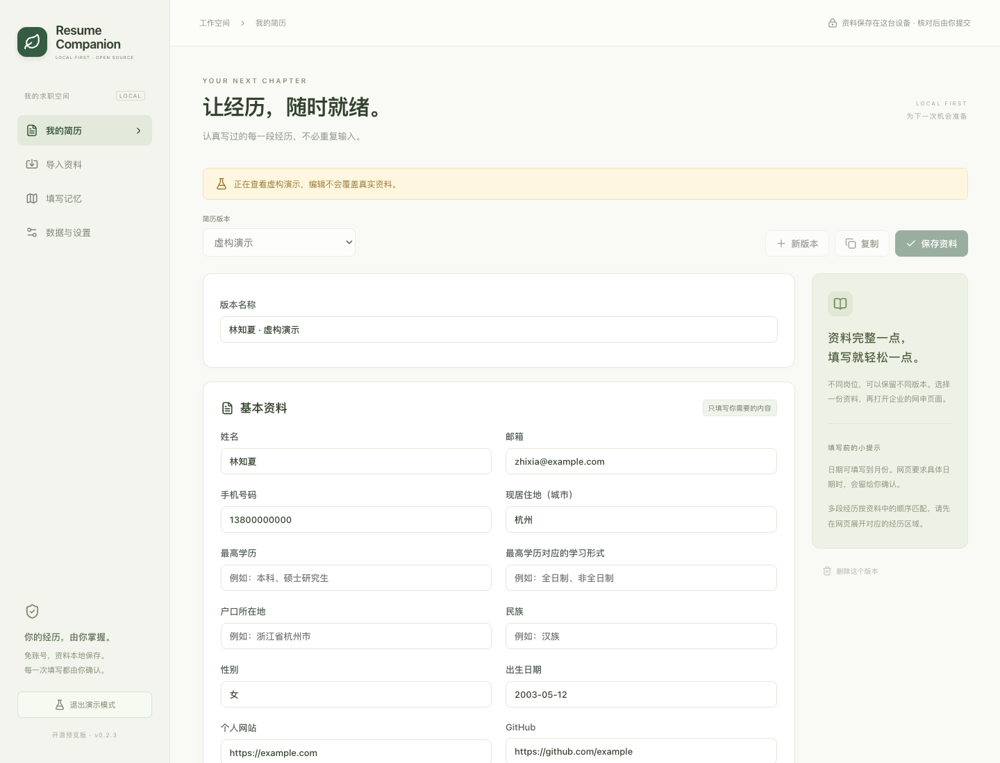

# Resume Companion

少填一遍，多一点从容。免登录、本地保存的校招简历填写扩展，适用于 Chrome / Edge。



[侧边栏预览](docs/screenshots/panel.png) · [本次实现与验证记录](docs/implementation-status.md)

**开发预览版 · 尚未在商店发布。** Moka、北森和飞书招聘目前只有实验域名识别与通用引擎，尚无真实企业页面的兼容验证。项目没有已完成的用户内测或竞品领先成绩。[English](README.en.md)

## 现在可以做什么

- 在独立管理页编辑多个简历版本、教育 / 实习 / 项目经历和自定义字段。
- 在侧边栏预览字段、选择资料来源、填写、回读校验和撤销；默认保留网页已有内容。
- 记住按站点保存的手动字段映射。修改表单结构后可能需要重新绑定。
- 本地提取文本型 PDF、DOCX、TXT；基础规则提取姓名、手机、邮箱、城市，其余资料手工核对录入。无 OCR，不将简历文件或提取文本发送给 AI。
- 使用密码加密备份与恢复；支持符合本项目格式的 JSON 导入。
- 可选自带 API Key 的 AI 识别并填写：直接采集页面文字、控件位置与层级，AI 对照不含值的资料 key 目录识别字段。预览请求并确认后，插件在本地取值，自动填写有效匹配项。
- 使用虚构演示简历测试本地页面，不把演示资料填入真实招聘网站。

插件不会自动提交申请。框架内嵌表单、Shadow DOM、复杂联动选择器和企业自定义控件可能需要手工填写；需要先在网站上添加多段经历的空白条目。

## 获取源码

项目仓库：[Odysseus-cyber/resume-companion](https://github.com/Odysseus-cyber/resume-companion)。当前开发版本为 **0.2.4 开发预览**，已归档基线为 `v0.2.3`；公开下载以 [Releases](https://github.com/Odysseus-cyber/resume-companion/releases) 中实际发布的版本为准，草稿 Release 仅维护者可见。

```sh
git clone https://github.com/Odysseus-cyber/resume-companion.git
cd resume-companion
```

## 选择控件（0.2.4 开发版）

支持明确关联 ARIA 弹层的只读选择入口、异步单选列表和省市区树。资料值在本地匹配和选择；有明确清空操作时可撤销，否则提示手动恢复。地区资料建议填写完整层级，如“浙江省/杭州市/余杭区”；只有城市时不推断区县。缺少弹层关联、纯视觉式分栏组件及哈啰实际页面仍需专门适配，详见 [支持范围](docs/support.md)。

## 本地开发与安装

需要 Node.js 22 或更高版本，使用 `package.json` 指定的 pnpm 版本。所有依赖和构建产物均位于本项目目录；隔离运行与清理方法见 [开发环境](docs/development.md)。

```sh
bash scripts/dev.sh install --frozen-lockfile
bash scripts/dev.sh dev
```

调试浏览器由 WXT 启动。若自动启动不可用，可手工加载 WXT 输出的开发目录。

```sh
bash scripts/dev.sh build
bash scripts/dev.sh build:edge
```

在 `chrome://extensions` 或 `edge://extensions` 打开开发者模式，选择“加载已解压的扩展程序”，加载 `.output/chrome-mv3` 或 `.output/edge-mv3`。固定工具栏图标，点击后打开侧边栏，进入资料管理页。

1. 手动建立简历或导入文件，核对并保存。
2. 打开并展开网申表单，在网站上添加所需空白经历条目，再点击扩展图标。
3. AI 关闭时选择“识别当前页面”，核对和勾选后点击“填写已选”。
4. AI 启用时选择“AI 识别并填写”，核对发送预览后点击“确认识别并填写”；插件自动填写有效匹配项，不确定、缺少资料或无法操作的控件会跳过。回到网页核对，必要时撤销。
5. 确认网页内容后自行提交。

## 验证与打包

```sh
bash scripts/dev.sh typecheck
bash scripts/dev.sh lint
bash scripts/dev.sh test
bash scripts/dev.sh exec playwright install chromium
bash scripts/dev.sh test:e2e
bash scripts/dev.sh zip
```

`pnpm check` 运行类型检查、静态检查、单元测试和 Chrome 构建；浏览器回归单独运行。测试页面是虚构夹具，不能代替真实企业系统兼容验证。

## 数据由你管理

简历、设置和映射保存于扩展的 `storage.local`；不使用云同步，不需要项目后台。普通本地库并未加密，加密只适用于导出的加密备份。卸载扩展或删除浏览器资料可能清除数据，操作前先备份。

AI 默认关闭。确认发送前，插件直接采集顶层已展开表单的文字块与候选控件位置、父子层级和顺序，不依赖规则先提取正确标签。请求包含经过脱敏的布局，以及标准资料 key、中文含义、类型和经历序号；自定义字段以临时别名表示，真实内部 ID 留在本地。AI 返回控件编号与 key 的语义对应，真实内容由插件本地读取。请求不包含填写值、网页已有值、选中内容、完整 HTML、原始 DOM 属性、截图或页面 URL。

单次最多 500 个候选控件，完整请求正文最多 200 KB；超出限制会提示缩小范围，不静默截断。页面布局、资料或控件状态发生变化时，旧结果不能继续自动填写。AI 请求失败不会自动改用规则填写。布局预览中的“导出脱敏布局”可保存不含填写值的 JSON，分享前仍请核对其中的页面文字；不要上传完整简历或浏览器会话数据。

页面文字会过滤已知简历值、页面已有值及常见敏感模式，但任意网站的自定义标签仍需你在发送预览中核对，不能将文字过滤视为对所有页面的绝对保证。服务商的费用及数据处理条款适用。API Key 仅存于扩展会话，作为服务鉴权发送，不放入 AI 消息正文、日志或备份。详见 [隐私说明](docs/privacy.html)。

## 文档与协作

- [静态产品说明](docs/index.html) · [支持范围](docs/support.md)
- [贡献指南](CONTRIBUTING.md) · [适配器接口](docs/adapters.md)
- [人工验收步骤](docs/testing.md) · [竞品基准模板](docs/benchmark.md)
- [商店发布材料](docs/release.md) · [安全报告](SECURITY.md)
- [第三方声明](THIRD_PARTY_NOTICES.md) · [变更记录](CHANGELOG.md)

由 [Odysseus-cyber](https://github.com/Odysseus-cyber) 维护，普通反馈使用 [Issues](https://github.com/Odysseus-cyber/resume-companion/issues)，安全问题遵循 [私密报告指引](SECURITY.md)。后续工作见 [维护路线](docs/roadmap.md)。商店账号、商店联系邮箱与公开隐私政策网页地址仍待配置，不影响源码开源。

## License

本项目代码以 [MIT](LICENSE) 发布；第三方依赖与改编组件保留各自许可证。WXT、React、shadcn/ui、Playwright 提供工程基础；同类项目 Job Buddy 和 Job Autofill + Tracker 仅作为交互设计参考，没有复制其业务代码。

### 识别进度与空资料

侧栏顶部区分“等待确认发送”“AI 识别中”“本地填写中”和最终结果。尚未确认时不会请求 AI；失败后可重新采集并识别。完整发送内容可展开查看。字段名称独立于资料匹配和填写结果，空资料、无对应 key 或不支持操作的字段也会尝试命名。

基本资料新增最高学历、最高学历对应学习形式、户口所在地和民族，均需独立录入，默认留空。数据格式为 v2，兼容迁移旧版数据库及备份。

AI 等待时间可在“管理资料 → 数据与设置”中指定（默认 30 秒），也可选择无限等待；识别过程中显示已等待秒数，支持主动取消。

填写期间按目标控件检查变化，正常校验提示或位置移动不停止整批填写。AI 优先语义复用资料；缺少的字段自动建为空自定义字段，可在侧栏输入一次并保存，之后复用。
